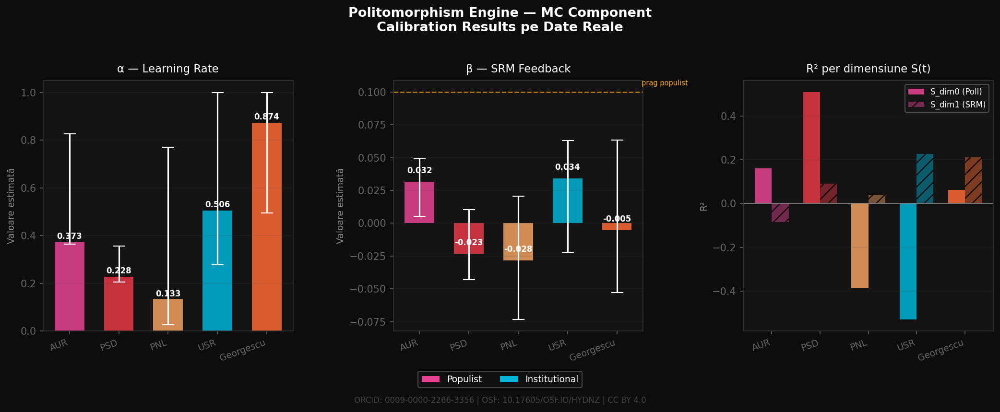
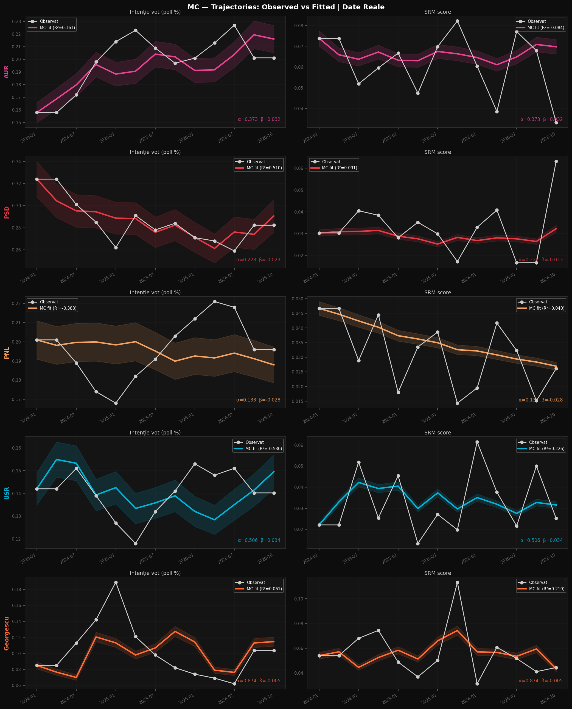
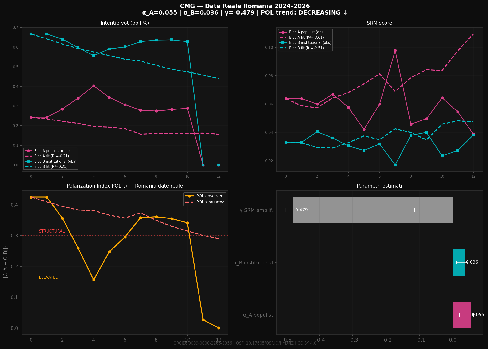

Politomorphism proposes a computational framework for studying political dynamics as a coupled system of symbolic resonance, cognitive frame change, institutional entropy, fragmentation, symbolic coherence, and legitimacy dynamics. Rather than treating these processes as isolated phenomena, the framework operationalizes them as interacting components and tests their empirical relationships using longitudinal and cross-national data.

The seven components are at different stages of empirical validation; the framework should therefore be understood as an evolving research program rather than a fully validated unified theory.

**Serban Gabriel Florin** | I.Researcher | Hannover, Germany  
ORCID: [0009-0000-2266-3356](https://orcid.org/0009-0000-2266-3356) | SSRN: https://papers.ssrn.com/sol3/cf_dev/AbsByAuth.cfm?per_id=10601216 
OSF: [10.17605/OSF.IO/HYDNZ](https://doi.org/10.17605/OSF.IO/HYDNZ) | GitHub: [github.com/politomorphism](https://github.com/politomorphism)  
ResearchGate: [Serban-Gabriel-Florin](https://www.researchgate.net/profile/Serban-Gabriel-Florin) | Academia.edu: [SerbanGabrielFlorin](https://independent.academia.edu/SerbanGabrielFlorin) | Google Scholar: [profile](https://scholar.google.com/citations?user=XibM3X0AAAAJ&hl=en)  
Substack: [profserban.substack.com](https://profserban.substack.com) | License: CC BY 4.0

---

## What is the Politomorphism Engine?

The Politomorphism Engine is a seven-component computational framework for analyzing political dynamics through symbolic resonance, cognitive frame evolution, institutional entropy, and legitimacy dynamics. It is the empirical core of **Politomorphism** — a paradigm in Computational Political Anthropology (CPA) developed by **Serban Gabriel Florin** as independent research (2024–2026).

The Engine models a closed feedback cycle:

```
MC(t) → CMG(t) → SRM(t) → EEF(t) → PFM(t) → ISC(t) → LDE(t) → MC(t+1)
```

---

## Quick Start

```bash
git clone https://github.com/politomorphism/Politomorphism.git
cd Politomorphism
pip install -r requirements.txt
python data_collector.py    # collect real RSS data
python fix_data.py          # or generate synthetic data
```

`data_collector.py` writes `data/real/sentiment_topics.csv`, `srm_scores.csv` and
`polling.csv`. The CMG code is included (`cmg_component.py`, `cmg_run.py`, CMG v1.1);
`cmg_run.py` stops if `outputs/MC_results.csv` is missing, but it does not use its values,
so the CMG result does not depend on the MC module.
The original `mc_component.py` (June 2026) was lost. The `mc_component.py` in this
repository is a reconstruction (MC v2.0, November 2026) written from the published
equation and from the interface `mc_run.py` expects; see the MC section below for what it
does and does not reproduce. To run CMG, either copy the saved `MC_results.csv` to
`outputs/MC_results.csv` or run `mc_run.py` first; the CMG estimates are the same either way.

---

## Repository Structure (as it is)

```
Politomorphism/
├── 05_lde_component/        # LDE calibration on Eurobarometer data
├── data/                    # Orbán 2010 content for the SRM→EEF coupling test
├── disinformation_paper/    # Orbán 2010 D, PE and ICI computations
├── isc/                     # ISC: Romanian parliamentary transcripts 2020 and scores
├── pfm_survival/            # PFM-Survival training data and model
├── politomorf_pipeline/     # automated Romanian political media monitoring
├── scripts/                 # EEF longitudinal panel, Orbán 2010 probes, model code
├── legacy/                  # earlier SRM D results (spring 2026) and an earlier README
├── .github/workflows/       # reproducible runs of the audits and the Orbán 2010 steps
├── mc_component.py, mc_run.py                       # MC v2.0 (reconstructed module)
├── MC_results.csv, MC_real_*.png                   # MC saved outputs (June 2026, original module)
├── cmg_component.py, cmg_run.py                    # CMG v1.1 code
├── CMG_real_results.csv, CMG_real_results.png      # CMG saved outputs
├── srm_*.csv, srm_*.png, SRM_*.png                 # SRM scores and figures
├── eef_chart_*.png                                 # EEF figures
├── audit_fezabilitate.py, audit_fezabilitate_v2.py, criterii_caz_B.md, cases.json
├── data_collector.py, fix_data.py, georgescu_temporal_ici.py
├── predictions_t0_20260610.json, srm_values_t0_20260610.csv
└── Computational Political Anthropology- Defining a New Field and Its Core Engine.pdf
```

---

## Component Status
| # | Code | Name | Status | SSRN |
|---|------|------|--------|------|
| 1 | MC | Metapolitical Calibration | ⚠️ June 2026 estimates not reproducible; module reconstructed, β not identified at 12 quarters | This repo |
| 2 | CMG | Cognitive Morphogenesis | ⚠️ Romania 2024–2026 results, reproduced from this repo (CMG v1.1); γ interval cut at the search bound | This repo |
| 3 | SRM | Social Resonance Model | ✅ 25 symbols, R²=0.770 | 6348318 |
| 4 | EEF | Entropic Equilibrium Function | ⚠️ Provisional — α=0.8116 validated on original 3 countries; 6-country extension (Estonia/Slovakia/Serbia) in progress, see the Data Integrity Note (PDF not yet in this repository) | 6677579 |
| 5 | PFM | Political Fragmentation Model | ✅ Published | 6729899 |
| 6 | ISC | Symbolic Coherence Index | ✅ Null result documented | 6826140 |
| 7 | LDE | Legitimacy Dynamics Engine | ❌ Pre-registered confirmatory test returned the opposite sign | 6850362 |

## Component 1 — MC: Metapolitical Calibration

```
S(t+1) = (1 - α) · S(t) + α · W · I(t) + β · SRM(t-1) + ε_MC(t)
```

**β Hypothesis:** Populist actors (AUR, Georgescu) have significantly higher β than institutional actors (PNL, PSD) — they recalibrate strategy more aggressively based on prior resonance feedback.

### Results — Romania 2024–2026 (June 2026 run of the original module, now lost)

| Actor | Type | α | β | β 95% CI |
|-------|------|---|---|----------|
| AUR | Populist | 0.373 | 0.032 | [0.005, 0.049] |
| Georgescu | Populist | 0.874 | −0.005 | [−0.053, 0.063] |
| PSD | Institutional | 0.228 | −0.023 | [−0.043, 0.010] |
| PNL | Institutional | 0.133 | −0.028 | [−0.073, 0.021] |
| USR | Institutional | 0.506 | 0.034 | [−0.022, 0.063] |

**Preliminary:** mean β of the populist actors (0.013) is above that of the institutional actors (−0.006), but the difference has not been formally tested and the intervals of several actors include zero, so the hypothesis is not yet established.

Georgescu α=0.874 — highest in dataset, consistent with flash-viral symbol profile and post-annulment symbolic exile dynamics (SSRN 6880661).

### Reconstruction (November 2026)

The module that produced the table above was lost and the table cannot be reproduced.
`mc_component.py` was rebuilt from the equation: the trajectory is simulated from the first
quarter, W and β are solved by least squares for each α, and α is chosen by grid search on
[0, 1]. No reasonable variant of the equation (W estimated or fixed, different SRM lags,
simulated or one-step-ahead fit) returns the June 2026 values on the data in this
repository, so the table above should be read as unverified.

Parameter recovery on synthetic data (`python mc_component.py`, true α = 0.35, β = 0.04):
α is recovered well at 12 quarters (median 0.345). β is not: with W estimated, the 90%
range of the recovered β is [−0.18, +0.29] and its sign is right in only 66% of runs; with
W known it is [+0.004, +0.071]. On the Romanian data the reconstructed module puts α at
the lower bound 0 for four of the five actors, which removes the W·I(t) term, and gives
β values from −0.88 to +0.20 with wide intervals. With 12 quarters and W estimated, the MC
β hypothesis cannot be tested; it needs a fixed or theory-given W, or a longer series.





---

## Component 2 — CMG: Cognitive Morphogenesis

```
C_A(t+1) = C_A(t) + α_A × (S_A(t) − C_A(t)) + γ × SRM_A(t)
C_B(t+1) = C_B(t) + α_B × (S_B(t) − C_B(t)) + γ × SRM_B(t)
POL(t)   = ||C_A(t) − C_B(t)||₂
```

- **Bloc A (populist):** AUR + Georgescu  
- **Bloc B (institutional):** PSD + PNL + USR

**Differential Update Rate Hypothesis:** α_A > α_B — populist-receptive subpopulation updates cognitive frames faster.

### Polarization Zones

| POL(t) | Zone |
|--------|------|
| > 0.30 | STRUCTURAL |
| 0.15–0.30 | ELEVATED |
| 0.05–0.15 | MODERATE |
| < 0.05 | LOW |

### Results — Romania 2024–2026

| Parameter | Estimate | 95% CI |
|-----------|----------|--------|
| α_A | 0.055 | [0.020, 0.062] |
| α_B | 0.036 | [0.012, 0.045] |
| γ | −0.479 | [−0.500, −0.114] |
| POL trend | −0.021 | DECREASING |

Reproduced exactly from `cmg_run.py` and the data in this repository (18 November 2026). The lower limit of the γ interval, −0.500, is the bound of the parameter search, so the interval is truncated and the true lower limit may be further below zero.

**Key finding:** γ = −0.479 entirely negative. Post-electoral annulment (Romania, Dec 2024): Georgescu's resonance driven by juridical exclusion narratives → resonance-induced frame *freezing*, not amplification. Consistent with Symbolic Exile framework (SSRN 6880661).



**Companion working paper:** *Operationalizing the Cognitive Maturation Gradient (CMG): A Transparent Measurement Framework, with Evidence from Romania (2005–2018)* documents a fully sourced, independently reproducible protocol (Eurostat tertiary-education series + WVS/EVS survey waves) for the national-level E(t)/T(t)/K(t)/C(t) trajectory — distinct from, and complementary to, the bloc-polarization application above. It fixes source selection, a mechanical shock-coding rule, theoretical-bound normalization, equal-weight defaults with a 3×3 sensitivity analysis, and introduces a formal **transition-zone rule** (|C(t) − τ| ≤ δ) for interpreting stage classifications near numeric thresholds, now part of CMG's general definition.

*Naming note:* the component is **Cognitive Morphogenesis** (bloc frame polarization); the companion paper uses the name *Cognitive Maturation Gradient* for the national-level measurement. The two share the abbreviation CMG; a single name is to be chosen by the author.

---

## Component 3 — SRM: Social Resonance Model

```
SRM = V × A × exp(−λ^0.20 × D^3.00) × N
```

**25 symbol-periods validated | LOOCV R²=0.770**

| Symbol | Context | SRM | Category |
|--------|---------|-----|----------|
| Imran Khan | PK, 2018 | 0.4349 | HIGH — Ultra-Sustained Ambient Saturation |
| Zelensky | UA/EU/US, 2022–26 | 0.1121 | MEDIUM — Distributed |
| Trump | US, 2015–16 | 0.0922 | MEDIUM — Electoral Burst |
| Georgescu | RO, Oct–Dec 2024 | 0.0800 | MEDIUM — Electoral Burst |
| Milei | AR, 2023–24 | 0.0455 | LOW |
| Ciolacu | RO, 2025–26 | 0.0345 | LOW |

CCFI confirmed: Cross-Cultural Frame Incompatibility does not decay to zero (Narendra Modi, India 2024).

---

## Component 4 — EEF: Entropic Equilibrium Function

```
IS(t) = α · H(t) + (1−α) · V(t)
H(t)  = S(t) / ln(3)              [normalized Shannon entropy]
V(t)  = 0.0·p₀ + 0.5·p₁ + 1.0·p₂
```

- Krippendorff α = 0.8116
- V-Dem convergent validity: r = −0.980 (Hungary), r = −0.941 (Poland)
- LOOCV accuracy = 1.000
- Superior early warning vs. Freedom House for Romania 2024
- 
Data Integrity: Freedom House NIT Scale Conversion (2005–2024)

Freedom House changed the coding convention of its Nations in Transit (NIT) 1–7 scale starting with the NIT 2020 edition (events of 2019), retroactively renumbering the historical series:

Old convention (through NIT 2019): 1 = most democratic, 7 = most authoritarian
New convention (NIT 2020 onward): 1 = most authoritarian, 7 = most democratic
Conversion: score_new = 8 − score_old

All indicator series in the EEF v4 panel are standardized to the new (7 = best) convention. This is a data-integrity correction, not a full numerical validation — see the note for the distinction between convention correction, coverage gaps, and fuzzy-transformation uncertainty still pending reconciliation.

📄 Full write-up: Data Integrity Note (PDF, not yet in this repository; see OSF)

Series	Status
Romania / Hungary / Poland — Judicial & Electoral	New convention; not yet line-by-line re-verified
Poland — Judicial 2016–2024, Electoral 2015–2024	Missing (coverage gap)
Estonia / Slovakia / Serbia — Judicial & Electoral	New convention; verified against official country reports
BTI Political Participation (Estonia/Slovakia/Serbia)	Not yet extracted (0/30 cells)

Author: Serban Gabriel Florin · ORCID: 0009-0000-2266-3356

## Component 5 — PFM: Political Fragmentation Model

```
PFM(t) = Σ[SRM_i × w_ij × exp(−δ × d_ij)] / EEF(t)
```

Formal theory of fragmentation propagation. Published SSRN 6729899.

---

## Component 6 — ISC: Symbolic Coherence Index

```
ISC_A(t) = 0.5 · CMP_A(t) + 0.5 · CI_A(t)
```

**Null result documented openly (SSRN 6826140):** ISC does not predict electoral support Romania 2019–2024.  
**Governing Party Penalty confirmed:** −1.1 pp/quarter (p < 0.001).

---

## Component 7 — LDE: Legitimacy Dynamics Engine

```
L(t+1) = L(t) + λ[α·P(t) + β·N(t) − γ·C(t)] − θ[L(t) − L*]
```

| Country | R² | 95% CI | Status |
|---------|-----|--------|--------|
| Greece | 0.624 | [0.416, 0.986] | ✅ Validated |
| Serbia | 0.308 | [0.065, 0.933] | ✅ Validated |
| Hungary | — | [−0.111, 0.967] | Inconclusive |
| Slovakia | 0.003 | [0.018, 0.836] | ❌ Null result — referent-instability diagnosis (partisan re-alignment of trust, not continuous shock-recovery) |

**Confirmatory test — result: opposite sign.** The transition-versus-stability hypothesis motivated by the Hungary/Slovakia results was converted into a pre-registered, falsifiable test — Bulgaria (high partisan turnover) vs. Portugal (low partisan turnover) — with country selection, crisis-coding rule and decision thresholds locked *before* data extraction (OSF registration um6gp, registered 21 July 2026). The test returned R²(Portugal) − R²(Bulgaria) = −0.2558, the opposite of the predicted sign. Calibration on the Romanian, Hungarian and Polish Eurobarometer series was non-identifiable at low series variance. LDE is therefore deprioritised; the result is reported, not withdrawn.

---

## SRM → EEF Coupling (in progress)

First empirical test of the theorized inter-component coupling mechanism (symbolic divergence generating systemic entropy, Π(t) = π₀ + π₁·ICI_var(t) + ε(t)). Requires a same-country SRM series calibrated across multiple distinct years, matched against EEF's existing longitudinal panel — a data structure that did not previously exist for any single leader. Building it now for Viktor Orbán (Hungary), whose EEF longitudinal series already spans 2005–2024.

| Year | λ | PE | ICI | D | A | N |
|------|-----|-------|------------------------|-------|-------|-------|
| 2010 | 2.14 | 0.468 | 0.710 [0.672, 0.745] | 0.589 | 0.278 | 0.208 |

Method: Google Trends (Brent's method for λ), Media Cloud (US National + US State & Local + European collections), LDA topic modeling (K=10, PE), sentence-embedding bootstrap n=200 (ICI), VADER (A). D = 0.5·PE + 0.5·ICI, fixed to match the already-calibrated Orbán reference point.

Remaining: 2014, 2018, and a recalculation of the existing single Orbán point on the same calendar-year window (2022) for full internal comparability before the coupling regression is estimated.

---

## Methodology

- LOOCV for all empirical results
- Bootstrap CIs (300–500 replications)
- Null results documented openly
- Adversarial review by AI assistants (Grok, ChatGPT) before SSRN submission — a check, not a substitute for peer review
- V-Dem v14 as convergent validity benchmark
- L-BFGS-B parametric optimization
- OSF pre-registration for prospective predictions

---
## Latest addition — Defensive Audit Layer (propaganda-technique detection)

**Status: 🔬 Early-stage / exploratory (2026). Two working papers, both corrected to v2 after independent reproduction audits.**

A detector that flags propagandistic vs. non-propagandistic news paragraphs, proposed as a *defensive* audit layer for the Engine — detection and measurement, never generation. Built on the English **PropXplain** corpus (QCRI). An article-level leakage problem in the corpus's official split (paragraphs from the same ~250 articles scattered across train/validation/test) was found and corrected by re-splitting so that no article spans two sets.

### Results — article-disjoint test set (n = 862; propagandistic class)

| Model | Precision | Recall | F1 | AP |
|-------|-----------|--------|----|----|
| TF-IDF + LR (baseline) | 0.464 | 0.606 | 0.525 [.47–.58] | 0.527 |
| DistilBERT (transformer) | 0.578 | 0.545 | 0.561 [.48–.63] | 0.606 |

At the models' default thresholds the F1 difference is **not** statistically distinguishable from zero (ΔF1 +0.033, 95% article-clustered bootstrap CI [−0.03, +0.09]). On threshold-independent / equal-cost comparisons the transformer is the better detector: average precision higher (ΔAP +0.074 [+0.00, +0.14]); recall at **matched review budget** higher (0.670 vs 0.606, Δ +0.068 [+0.01, +0.12]); and significantly more correct classifications (McNemar 148 vs 84, p < 0.001). Paired transitions show the two models miss *different* cases, not the same ones.

### Honest scope

A classification score is **not** a validated measure of "manipulation density," and the detector must not be used to arbitrate which political positions are legitimate — it flags verifiable discursive features at most. All results are single fixed-seed runs; construct validity, multi-seed training, and a purpose-built contrastive-pairs benchmark are future work. This layer does **not** validate the broader framework.

**Code & papers:** [github.com/politomorphism/politomorphism-defense](https://github.com/politomorphism/politomorphism-defense) — Working Paper I (transparent baseline) and Working Paper II (leakage-corrected transformer comparison), both v2 (corrected).

## Citation
Archer, M. S. (1995). Realist Social Theory: The Morphogenetic Approach. Cambridge University Press.

Blei, D. M., Ng, A. Y., & Jordan, M. I. (2003). Latent Dirichlet allocation. Journal of Machine Learning Research, 3, 993–1022.

Hutto, C. J., & Gilbert, E. (2014). VADER: A parsimonious rule-based model for sentiment analysis of social media text. Proceedings of ICWSM-14.

Reimers, N., & Gurevych, I. (2019). Sentence-BERT: Sentence embeddings using Siamese BERT-networks. Proceedings of EMNLP-IJCNLP 2019.

Shannon, C. E. (1948). A mathematical theory of communication. Bell System Technical Journal, 27(3), 379–423.

Șerban, G. F. (2026). Politomorphism and the Social Resonance Model: Quantifying political symbolic fragmentation across 22 symbol-periods. SSRN working paper; OSF DOI 10.17605/OSF.IO/HYDNZ.

Șerban, G. F. (2026). Operationalizing semantic drift (D) in the Social Resonance Model. SSRN 6583879.

Șerban, G. F. (2026). The Politomorphism Engine: Full empirical validation (bootstrap ICI, parametric optimization, Prophet forecasting). SSRN working paper.

Șerban, G. F. (2026). Politomorphism: Clarifying intentional and emergent processes (Module 3.1). SSRN preprint.

Șerban, G. F. (2026). The Politomorphism Engine: A five-component framework for computational political analysis. SSRN working paper.

Șerban, G. F. (2026). Coupling SRM, EEF, and ISC: The adaptive layer of the Politomorphism Engine. OSF DOI 10.17605/OSF.IO/HYDNZ.

Șerban, G. F. (2026). Measuring political systemic instability: The Entropic Equilibrium Function (EEF). SSRN working paper.

Șerban, G. F. (2026). The Political Fragmentation Model (PFM): A formal theory of fragmentation propagation in political systems. SSRN working paper.

Șerban, G. F. (2026). PFM-Survival: Pre-registered random survival forest prediction of political symbol attention decay. SSRN working paper.

Șerban, G. F. (2026). Cognitive Morphogenesis (CMG): Modeling collective frame polarization. SSRN working paper.

Șerban, G. F. (2026). Metapolitical Calibration (MC): Formalizing strategic adaptation. SSRN 6918918.

Șerban, G. F. (2026). The Symbolic Coherence Index does not predict electoral support in Romania 2019–2024; Parliamentary speech coherence does not predict electoral support. Null-result working papers.

Șerban, G. F. (2026). The Legitimacy Dynamics Engine: Preliminary calibration on Romania, Hungary and Poland; Cross-national calibration on Standard Eurobarometer data (2014–2025). Working papers.

Șerban, G. F. (2026). Cross-cultural frame incompatibility: Modi 2014, 2019 and 2024; Imran Khan 2018; Milei 2023; Meloni 2021–2024; Harris 2024 and the VP baseline effect. SSRN working papers.


