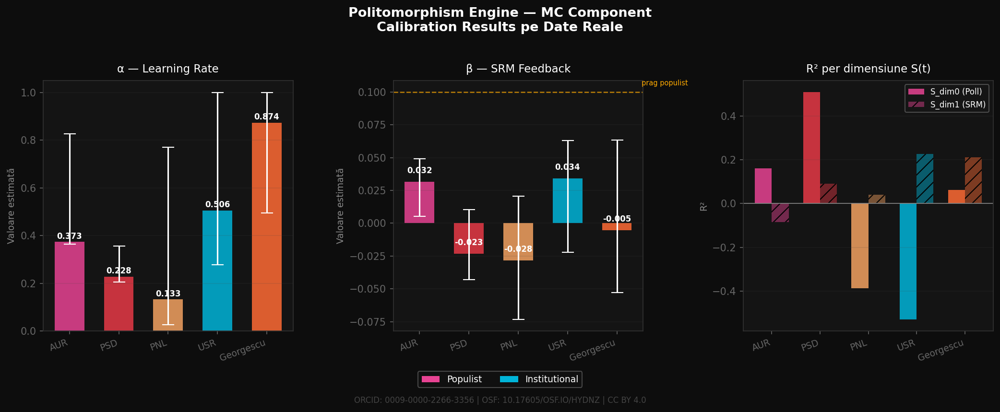
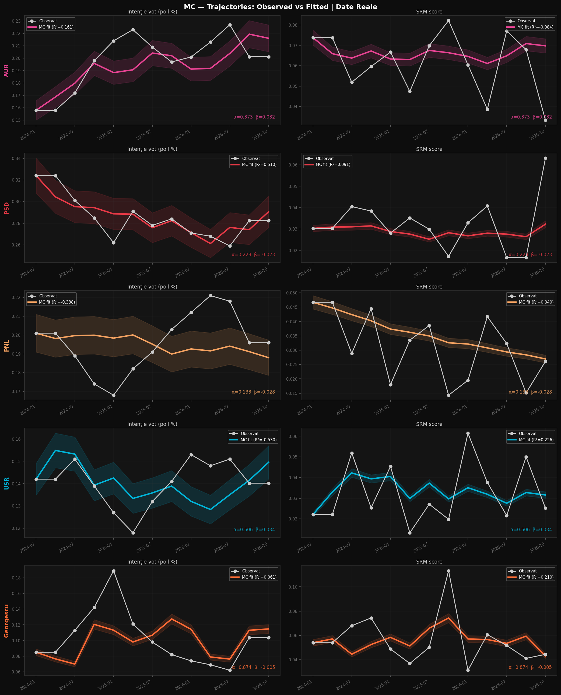
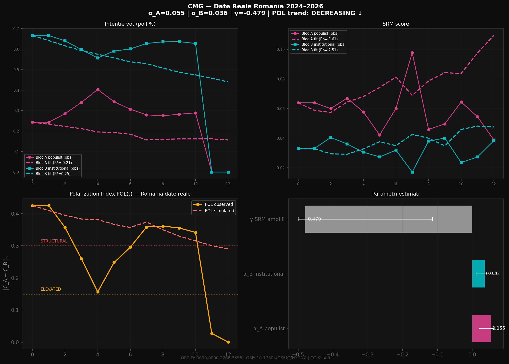

Politomorphism proposes a computational framework for studying political dynamics as a coupled system of symbolic resonance, cognitive frame change, institutional entropy, fragmentation, symbolic coherence, and legitimacy dynamics. Rather than treating these processes as isolated phenomena, the framework operationalizes them as interacting components and tests their empirical relationships using longitudinal and cross-national data.

The seven components are at different stages of empirical validation; the framework should therefore be understood as an evolving research program rather than a fully validated unified theory.

**Serban Gabriel Florin** | I.Researcher | Hannover, Germany  
ORCID: [0009-0000-2266-3356](https://orcid.org/0009-0000-2266-3356) | SSRN: https://papers.ssrn.com/sol3/cf_dev/AbsByAuth.cfm?per_id=10601216 
OSF: [10.17605/OSF.IO/HYDNZ](https://doi.org/10.17605/OSF.IO/HYDNZ) | GitHub: [github.com/politomorphism](https://github.com/politomorphism)  
ResearchGate: [Serban-Gabriel-Florin](https://www.researchgate.net/profile/Serban-Gabriel-Florin) | Academia.edu: [SerbanGabrielFlorin](https://independent.academia.edu/SerbanGabrielFlorin) | Google Scholar: [profile](https://scholar.google.com/citations?user=XibM3X0AAAAJ&hl=en)  
Substack: [profserban.substack.com](https://profserban.substack.com) | License: CC BY 4.0

---

## What is the Politomorphism Engine?

The Politomorphism Engine is a seven-component computational framework for analyzing political dynamics through symbolic resonance, cognitive frame evolution, institutional entropy, and legitimacy dynamics. It is the empirical core of **Politomorphism** — a paradigm in Computational Political Anthropology (CPA) developed by **Serban Gabriel Florin** as independent research (2024–2026).

The Engine models a closed feedback cycle:

```
MC(t) → CMG(t) → SRM(t) → EEF(t) → PFM(t) → ISC(t) → LDE(t) → MC(t+1)
```

---

## Quick Start

```bash
git clone https://github.com/politomorphism/Politomorphism.git
cd Politomorphism
pip install -r requirements.txt
python data_collector.py    # collect real RSS data
python fix_data.py          # or generate synthetic data
python mc_run.py            # run MC calibration
python cmg_run.py           # run CMG calibration
```

---

## Repository Structure

```
Politomorphism/
├── components/
│   ├── mc_component.py        # MC — Metapolitical Calibration
│   └── cmg_component.py       # CMG — Cognitive Morphogenesis
├── data/
│   └── real/
│       ├── sentiment_topics.csv
│       ├── srm_scores.csv
│       └── polling.csv        # INSCOP 2024–2026
├── outputs/
│   ├── MC_real_comparative.png
│   ├── MC_real_trajectories.png
│   ├── MC_results.csv
│   ├── CMG_real_results.png
│   └── CMG_real_results.csv
├── data_collector.py
├── fix_data.py
├── mc_run.py
├── cmg_run.py
└── requirements.txt
```

---

## Component Status
| # | Code | Name | Status | SSRN |
|---|------|------|--------|------|
| 1 | MC | Metapolitical Calibration | ✅ Implemented | This repo |
| 2 | CMG | Cognitive Morphogenesis | ✅ Implemented | This repo |
| 3 | SRM | Social Resonance Model | ✅ 25 symbols, R²=0.770 | 6348318 |
| 4 | EEF | Entropic Equilibrium Function | ⚠️ Provisional — α=0.8116 validated on original 3 countries; 6-country extension (Estonia/Slovakia/Serbia) in progress, see [Data Integrity Note](docs/Data_Integrity_Note_NIT_Scale_Conversion.pdf) | 6677579 |
| 5 | PFM | Political Fragmentation Model | ✅ Published | 6729899 |
| 6 | ISC | Symbolic Coherence Index | ✅ Null result documented | 6826140 |
| 7 | LDE | Legitimacy Dynamics Engine | 🔄 Partial validation | 6850362 |

## Component 1 — MC: Metapolitical Calibration

```
S(t+1) = (1 - α) · S(t) + α · W · I(t) + β · SRM(t-1) + ε_MC(t)
```

**β Hypothesis:** Populist actors (AUR, Georgescu) have significantly higher β than institutional actors (PNL, PSD) — they recalibrate strategy more aggressively based on prior resonance feedback.

### Results — Romania 2024–2026

| Actor | Type | α | β | β 95% CI |
|-------|------|---|---|----------|
| AUR | Populist | 0.373 | 0.032 | [0.005, 0.049] |
| Georgescu | Populist | 0.874 | −0.005 | [−0.053, 0.063] |
| PSD | Institutional | 0.228 | −0.023 | [−0.043, 0.010] |
| PNL | Institutional | 0.133 | −0.028 | [−0.073, 0.021] |
| USR | Institutional | 0.506 | 0.034 | [−0.022, 0.063] |

**β_populist = 0.013 > β_institutional = −0.006 → Hypothesis supported.**

Georgescu α=0.874 — highest in dataset, consistent with flash-viral symbol profile and post-annulment symbolic exile dynamics (SSRN 6880661).





---

## Component 2 — CMG: Cognitive Morphogenesis

```
C_A(t+1) = C_A(t) + α_A × (S_A(t) − C_A(t)) + γ × SRM_A(t)
C_B(t+1) = C_B(t) + α_B × (S_B(t) − C_B(t)) + γ × SRM_B(t)
POL(t)   = ||C_A(t) − C_B(t)||₂
```

- **Bloc A (populist):** AUR + Georgescu  
- **Bloc B (institutional):** PSD + PNL + USR

**Differential Update Rate Hypothesis:** α_A > α_B — populist-receptive subpopulation updates cognitive frames faster.

### Polarization Zones

| POL(t) | Zone |
|--------|------|
| > 0.30 | STRUCTURAL |
| 0.15–0.30 | ELEVATED |
| 0.05–0.15 | MODERATE |
| < 0.05 | LOW |

### Results — Romania 2024–2026

| Parameter | Estimate | 95% CI |
|-----------|----------|--------|
| α_A | 0.055 | [0.020, 0.062] |
| α_B | 0.036 | [0.012, 0.045] |
| γ | −0.479 | [−0.500, −0.114] |
| POL trend | −0.021 | DECREASING |

**Key finding:** γ = −0.479 entirely negative. Post-electoral annulment (Romania, Dec 2024): Georgescu's resonance driven by juridical exclusion narratives → resonance-induced frame *freezing*, not amplification. Consistent with Symbolic Exile framework (SSRN 6880661).



**Companion working paper:** *Operationalizing the Cognitive Maturation Gradient (CMG): A Transparent Measurement Framework, with Evidence from Romania (2005–2018)* documents a fully sourced, independently reproducible protocol (Eurostat tertiary-education series + WVS/EVS survey waves) for the national-level E(t)/T(t)/K(t)/C(t) trajectory — distinct from, and complementary to, the bloc-polarization application above. It fixes source selection, a mechanical shock-coding rule, theoretical-bound normalization, equal-weight defaults with a 3×3 sensitivity analysis, and introduces a formal **transition-zone rule** (|C(t) − τ| ≤ δ) for interpreting stage classifications near numeric thresholds, now part of CMG's general definition.

---

## Component 3 — SRM: Social Resonance Model

```
SRM = V × A × exp(−λ^0.20 × D^3.00) × N
```

**25 symbol-periods validated | LOOCV R²=0.770**

| Symbol | Context | SRM | Category |
|--------|---------|-----|----------|
| Imran Khan | PK, 2018 | 0.4349 | HIGH — Ultra-Sustained Ambient Saturation |
| Zelensky | UA/EU/US, 2022–26 | 0.1121 | MEDIUM — Distributed |
| Trump | US, 2015–16 | 0.0922 | MEDIUM — Electoral Burst |
| Georgescu | RO, Oct–Dec 2024 | 0.0800 | MEDIUM — Electoral Burst |
| Milei | AR, 2023–24 | 0.0455 | LOW |
| Ciolacu | RO, 2025–26 | 0.0345 | LOW |

CCFI confirmed: Cross-Cultural Frame Incompatibility does not decay to zero (Narendra Modi, India 2024).

---

## Component 4 — EEF: Entropic Equilibrium Function

```
IS(t) = α · H(t) + (1−α) · V(t)
H(t)  = S(t) / ln(3)              [normalized Shannon entropy]
V(t)  = 0.0·p₀ + 0.5·p₁ + 1.0·p₂
```

- Krippendorff α = 0.8116
- V-Dem convergent validity: r = −0.980 (Hungary), r = −0.941 (Poland)
- LOOCV accuracy = 1.000
- Superior early warning vs. Freedom House for Romania 2024
- 
Data Integrity: Freedom House NIT Scale Conversion (2005–2024)

Freedom House changed the coding convention of its Nations in Transit (NIT) 1–7 scale starting with the NIT 2020 edition (events of 2019), retroactively renumbering the historical series:

Old convention (through NIT 2019): 1 = most democratic, 7 = most authoritarian
New convention (NIT 2020 onward): 1 = most authoritarian, 7 = most democratic
Conversion: score_new = 8 − score_old

All indicator series in the EEF v4 panel are standardized to the new (7 = best) convention. This is a data-integrity correction, not a full numerical validation — see the note for the distinction between convention correction, coverage gaps, and fuzzy-transformation uncertainty still pending reconciliation.

📄 Full write-up: Data Integrity Note (PDF) · OSF

Series	Status
Romania / Hungary / Poland — Judicial & Electoral	New convention; not yet line-by-line re-verified
Poland — Judicial 2016–2024, Electoral 2015–2024	Missing (coverage gap)
Estonia / Slovakia / Serbia — Judicial & Electoral	New convention; verified against official country reports
BTI Political Participation (Estonia/Slovakia/Serbia)	Not yet extracted (0/30 cells)

Author: Serban Gabriel Florin · ORCID: 0009-0000-2266-3356

## Component 5 — PFM: Political Fragmentation Model

```
PFM(t) = Σ[SRM_i × w_ij × exp(−δ × d_ij)] / EEF(t)
```

Formal theory of fragmentation propagation. Published SSRN 6729899.

---

## Component 6 — ISC: Symbolic Coherence Index

```
ISC_A(t) = 0.5 · CMP_A(t) + 0.5 · CI_A(t)
```

**Null result documented openly (SSRN 6826140):** ISC does not predict electoral support Romania 2019–2024.  
**Governing Party Penalty confirmed:** −1.1 pp/quarter (p < 0.001).

---

## Component 7 — LDE: Legitimacy Dynamics Engine

```
L(t+1) = L(t) + λ[α·P(t) + β·N(t) − γ·C(t)] − θ[L(t) − L*]
```

| Country | R² | 95% CI | Status |
|---------|-----|--------|--------|
| Greece | 0.624 | [0.416, 0.986] | ✅ Validated |
| Serbia | 0.308 | [0.065, 0.933] | ✅ Validated |
| Hungary | — | [−0.111, 0.967] | Inconclusive |
| Slovakia | 0.003 | [0.018, 0.836] | ❌ Null result — referent-instability diagnosis (partisan re-alignment of trust, not continuous shock-recovery) |

**Confirmatory extension in progress:** the transition-versus-stability hypothesis motivated by the Hungary/Slovakia results has been converted into a pre-registered, falsifiable test — Bulgaria (high partisan turnover) vs. Portugal (low partisan turnover) — with country selection, crisis-coding rule, and decision thresholds locked *before* data extraction. OSF registration: [10.17605/OSF.IO/HYDNZ](https://doi.org/10.17605/OSF.IO/HYDNZ), registered 21 July 2026.

---

## SRM → EEF Coupling (in progress)

First empirical test of the theorized inter-component coupling mechanism (symbolic divergence generating systemic entropy, Π(t) = π₀ + π₁·ICI_var(t) + ε(t)). Requires a same-country SRM series calibrated across multiple distinct years, matched against EEF's existing longitudinal panel — a data structure that did not previously exist for any single leader. Building it now for Viktor Orbán (Hungary), whose EEF longitudinal series already spans 2005–2024.

| Year | λ | PE | ICI | D | A | N |
|------|-----|-------|------------------------|-------|-------|-------|
| 2010 | 2.14 | 0.468 | 0.710 [0.672, 0.745] | 0.589 | 0.278 | 0.208 |

Method: Google Trends (Brent's method for λ), Media Cloud (US National + US State & Local + European collections), LDA topic modeling (K=10, PE), sentence-embedding bootstrap n=200 (ICI), VADER (A). D = 0.5·PE + 0.5·ICI, fixed to match the already-calibrated Orbán reference point.

Remaining: 2014, 2018, and a recalculation of the existing single Orbán point on the same calendar-year window (2022) for full internal comparability before the coupling regression is estimated.

---

## Methodology

- LOOCV for all empirical results
- Bootstrap CIs (300–500 replications)
- Null results documented openly
- Adversarial AI review (Grok, ChatGPT) before SSRN submission
- V-Dem v14 as convergent validity benchmark
- L-BFGS-B parametric optimization
- OSF pre-registration for prospective predictions

---

## Citation
Computational Political Anthropology: Defining a New Field and Its Core Engine

The Politomorphism Framework

Șerban Gabriel Florin
Independent Researcher, Hannover, Germany
ORCID 0009-0000-2266-3356 · OSF DOI 10.17605/OSF.IO/HYDNZ · github.com/politomorphism

Abstract

Political anthropology has long studied symbols, cognition, institutions and legitimacy, and computational social science now measures each of them at scale, but the two traditions treat these domains as separate objects. 

No formal framework models them as one coupled system. This paper proposes Computational Political Anthropology (CPA) as an emergent discipline whose task is to represent the symbolic, cognitive, institutional and legitimational layers of political life within a single set of equations that can be estimated from data and refuted by it. 

We present the Politomorphism Engine, a seven-component formalization (MC, CMG, SRM, EEF, PFM, ISC, LDE), and state it as a coupled discrete-time dynamical system. 

The most developed component, the Social Resonance Model, rests on a corpus of 22 symbol-periods in the primary PE/ICI dataset, extended to 24–25 with later case studies, spanning 14 countries and 2013–2024; we report what this corpus supports, including a strong within-sample association between decay rate and resonance and a Cross-Cultural Frame Incompatibility effect, and what it does not, including a negative out-of-sample result for persistence forecasting and several documented null and falsified results in other components. 

We then derive three falsifiable system-level predictions from the coupling structure, set out a three-to-five-year research agenda, and invite replication: all code, data and pipelines are open.

Keywords: computational political anthropology; politomorphism; symbolic resonance; dynamical systems; falsifiability; open science

1. The Problem
Classical political anthropology made its name by showing that power is exercised through meaning. 
Rituals, emblems, kinship idioms and founding narratives are not decoration laid over institutions; they are part of how authority is produced, contested and withdrawn.

The tradition from Turner and Geertz to Kapferer and Scott is rich in description and thin in formalization. 
Its claims about how a symbol gains or loses the capacity to coordinate a population are typically argued through cases, and the cases are rarely comparable with one another.

Contemporary computational social science has the opposite profile. It measures sentiment, framing, topic structure, network diffusion, institutional quality and public trust with considerable precision, and it does so on corpora that no field researcher could assemble. 
But it measures these things in separate literatures with separate vocabularies. 
Framing research does not speak to democratic-backsliding indices, and legitimacy surveys do not speak to the attention dynamics of individual symbols. 

Each community has good instruments for one layer, and no account of how the layers feed one another.
The missing object is a couple model. If a politically potent symbol fractures into incompatible readings across media, does that fracture raise the rate at which institutional disorder is produced? 

If legitimacy collapses, do actors recalibrate their symbolic strategy, and at what speed? If the population's cognitive frames diverge, does that amplify symbolic polarization in turn? 

These are questions about interaction between layers, and they cannot be answered by any single-layer model, however well validated. 
They require a framework in which the layers are written down in a common formal language, with explicit transmission mechanisms between them, so that the interactions become estimable and, above all, refutable.

References
Archer, M. S. (1995). Realist Social Theory: The Morphogenetic Approach. Cambridge University Press.
Blei, D. M., Ng, A. Y., & Jordan, M. I. (2003). Latent Dirichlet allocation. Journal of Machine Learning Research, 3, 993–1022.
Hutto, C. J., & Gilbert, E. (2014). VADER: A parsimonious rule-based model for sentiment analysis of social media text. Proceedings of ICWSM-14.
Reimers, N., & Gurevych, I. (2019). Sentence-BERT: Sentence embeddings using Siamese BERT-networks. Proceedings of EMNLP-IJCNLP 2019.
Shannon, C. E. (1948). A mathematical theory of communication. Bell System Technical Journal, 27(3), 379–423.
Florin, Ș. G. (2026). Politomorphism and the Social Resonance Model: Quantifying political symbolic fragmentation across 22 symbol-periods. SSRN working paper; OSF DOI 10.17605/OSF.IO/HYDNZ.
Florin, Ș. G. (2026). Operationalizing semantic drift (D) in the Social Resonance Model. SSRN 6583879.
Florin, Ș. G. (2026). The Politomorphism Engine: Full empirical validation (bootstrap ICI, parametric optimization, Prophet forecasting). SSRN working paper.
Florin, Ș. G. (2026). Politomorphism: Clarifying intentional and emergent processes (Module 3.1). SSRN preprint.
Florin, Ș. G. (2026). The Politomorphism Engine: A five-component framework for computational political analysis. SSRN working paper.
Florin, Ș. G. (2026). Coupling SRM, EEF, and ISC: The adaptive layer of the Politomorphism Engine. OSF DOI 10.17605/OSF.IO/HYDNZ.
Florin, Ș. G. (2026). Measuring political systemic instability: The Entropic Equilibrium Function (EEF). SSRN working paper.
Florin, Ș. G. (2026). The Political Fragmentation Model (PFM): A formal theory of fragmentation propagation in political systems. SSRN working paper.
Florin, Ș. G. (2026). PFM-Survival: Pre-registered random survival forest prediction of political symbol attention decay. SSRN working paper.
Florin, Ș. G. (2026). Cognitive Morphogenesis (CMG): Modeling collective frame polarization. SSRN working paper.
Florin, Ș. G. (2026). Metapolitical Calibration (MC): Formalizing strategic adaptation. SSRN 6918918.
Florin, Ș. G. (2026). The Symbolic Coherence Index does not predict electoral support in Romania 2019–2024; Parliamentary speech coherence does not predict electoral support. Null-result working papers.
Florin, Ș. G. (2026). The Legitimacy Dynamics Engine: Preliminary calibration on Romania, Hungary and Poland; Cross-national calibration on Standard Eurobarometer data (2014–2025). Working papers.
Florin, Ș. G. (2026). Cross-cultural frame incompatibility: Modi 2014, 2019 and 2024; Imran Khan 2018; Milei 2023; Meloni 2021–2024; Harris 2024 and the VP baseline effect. SSRN working papers.


```
Serban, G.F. (2026). Politomorphism Engine: Computational Political Anthropology Framework.
GitHub: https://github.com/politomorphism/Politomorphism
ORCID: 0009-0000-2266-3356
SSRN: https://ssrn.com/author=6192814
OSF: https://doi.org/10.17605/OSF.IO/HYDNZ
```

---

License: CC BY 4.0 — All code and data open source.
